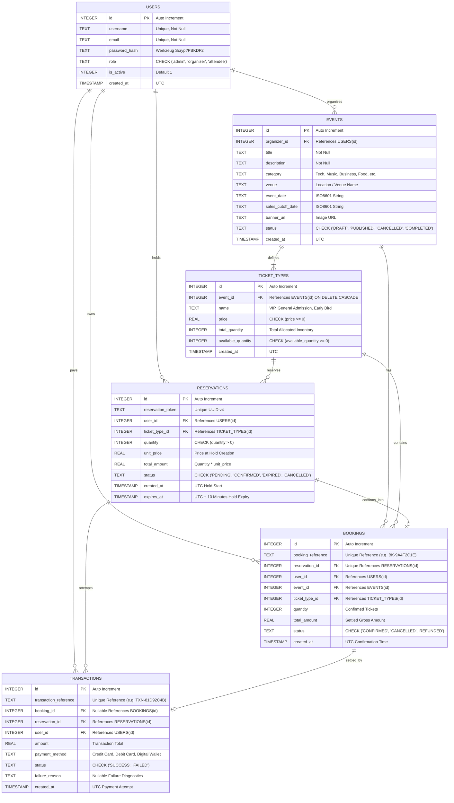

# EventEase Database Architecture & Entity Relationship Diagram

This document illustrates the relational schema, constraints, indexes, and concurrency guarantees implemented in **EventEase – Multi-Tenant Event & Ticket Reservation System**.

---

## 1. Mermaid Entity Relationship (ER) Diagram



---

## 2. Table Schemas & Constraints Overview

| Table | Primary Key | Foreign Keys | Key Constraints & Integrity Rules |
| :--- | :--- | :--- | :--- |
| `users` | `id` | None | Unique `username`, unique `email`, role restricted to `admin`, `organizer`, `attendee`. |
| `events` | `id` | `organizer_id` &rarr; `users(id)` | Cascading deletes, valid status constraint (`PUBLISHED`, `DRAFT`, `CANCELLED`). |
| `ticket_types` | `id` | `event_id` &rarr; `events(id)` | Non-negative constraint `available_quantity >= 0`, `price >= 0`. |
| `reservations` | `id` | `user_id`, `ticket_type_id` | 10-minute hold window, `status IN ('PENDING', 'CONFIRMED', 'EXPIRED', 'CANCELLED')`. |
| `bookings` | `id` | `reservation_id`, `user_id`, `event_id`, `ticket_type_id` | Unique `booking_reference`, `reservation_id` 1-to-1 confirmation relationship. |
| `transactions` | `id` | `booking_id`, `reservation_id`, `user_id` | Full audit trail with status (`SUCCESS` / `FAILED`) and diagnostics. |

---

## 3. High Concurrency & Inventory Protection Mechanism

```
Attendee Request (Quantity: Q)
              │
              ▼
   [BEGIN IMMEDIATE Transaction]  <-- Locks SQLite write mutex immediately
              │
              ▼
   [Atomic Conditional UPDATE]
   UPDATE ticket_types
   SET available_quantity = available_quantity - Q
   WHERE id = ? AND available_quantity >= Q;
              │
        Rows Affected?
       ┌──────┴──────┐
   (== 1)          (== 0)
     │               │
     │               ▼
     │        [ROLLBACK] & Return "Insufficient Tickets"
     ▼
[INSERT INTO reservations (expires_at = now + 10m)]
     │
     ▼
 [COMMIT] & Return Hold Token
```
